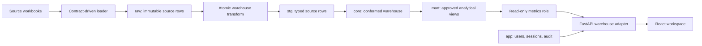

# Warehouse Application Architecture

The schema package at `ellementry data schema/ellementry_dw` is the canonical business-data model. Its reviewed SQL, source contracts, seeds, transforms, and marts own all business data and definitions. The application does not create a parallel fact model.

## Data Ownership

- `meta`, `ref`, `raw`, `stg`, `core`, `mart`, and `insight` belong to the warehouse package. Build and change them only through its ordered SQL and reviewed migrations.
- `loader/` validates registered source contracts and writes exact source values to the source-specific raw tables. It does not apply business classifications.
- `transform/` atomically rebuilds staging, dimensions, facts, ledger, quality results, coverage, and mart views. ERROR-level reconciliation checks roll back the complete build.
- `seeds/` contains reviewed, version-controlled rules and reference mappings. The seed loader refuses to silently remove register history.
- `app/` is a portal-only schema for account hashes, sessions, audit records, and login rate limits. `mart.v_portal_*` views expose only catalog, source, load, transform, rules, gaps, and source-note fields needed by the UI.

## Application Boundary

The app serves a fixed report allowlist from `backend/app/warehouse.py`. Report names, view names, order columns, and filter columns are code-owned; filter values are bound parameters. The metrics connection is transaction-read-only and receives SELECT on `mart` only. It cannot select `raw`, `stg`, `core`, `meta`, or `app` directly.

The app connection can read and mutate only the portal `app` schema. Authentication uses Argon2 hashes, random HttpOnly/SameSite session cookies, CSRF tokens, rate limits, configured Host/origin checks, and audit records. Database administrator credentials are not used by the web process.

The UI reports these actual warehouse views: net sales, latest stock, days of cover, returns, transfers in transit, open purchase orders, supplier lead time, partner review, data quality, process coverage, source contracts, load batches, transform runs, business rules, data gaps, and source notes. There is no app-owned workbook importer, direct core editor, generated SQL, or unrestricted model agent.

## Local Migration And Roles

`migrations/003_warehouse_portal.sql` adds only the portal schema and portal views. `backend/app/cli.py migrate` refuses to run unless the canonical warehouse tables exist. `grant-roles` grants the app role access to `app`, and the read-only metrics role access to `mart` only.

Run the warehouse package's fresh database build before the portal migration. Do not apply warehouse build scripts to a populated database; evolve it using numbered warehouse migrations. The old app database is not automatically merged into a warehouse database.

## Failure Semantics

Source contract failures do not commit raw rows. Warehouse transforms are atomic and preserve the previous successful build on quality-gate failure. Reports return only rows available in their selected mart and filters; absent rows are not synthesized into zero values. Report output is capped at 500 rows. Narrow filters before export when a result reaches that cap.
